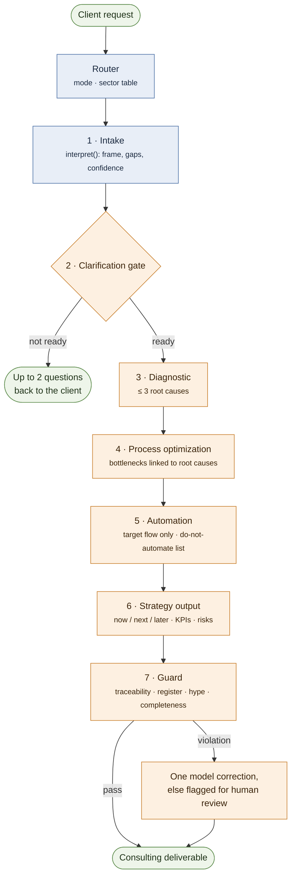
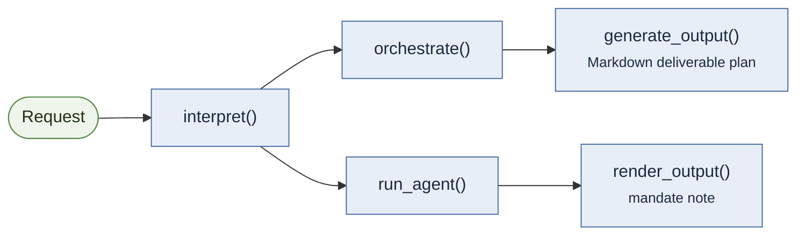

# Khirami Agent

[](https://github.com/nassim-systems/khirami-agent/actions/workflows/ci.yml)


The core of an AI business-consulting agent: it frames a client request,
routes it through a consulting pipeline, and guards the deliverable before it
reaches the client. The core is pure Python with no runtime dependency, and
everything outside the model calls is deterministic. An optional Anthropic
adapter runs the full engagement on Claude.

## The problem

A language model asked to "help with our support backlog" tends to answer
like an engineer or a salesperson. It jumps to tools, invents figures,
automates broken processes and loses track of why each recommendation exists.

Khirami Agent puts a consulting discipline around the model:

- **Frame before answering.** Requests are parsed into objective, recipient,
  tone, depth, constraints, quoted focus and measurable targets. Gaps are
  named, and low-confidence requests trigger at most two clarification
  questions.
- **Process before automation.** The automation stage only sees the
  *redesigned* process, never the current one.
- **Traceability.** Every action must point to an upstream root cause,
  bottleneck or automation candidate. A deterministic guard flags orphans,
  missing owners, missing done-conditions, engineering jargon and hype.
- **No invented data.** The prompts require every estimate to state its
  basis. Without a model client, stages return empty contracts and declare
  the gap. They never fabricate content.

## Architecture

The consulting engagement runs seven modules after a deterministic router.
Blue steps are pure Python; orange steps call the model, or can.



The execution mode decides which of modules 3 to 7 run (see the mode table
below). Two deterministic stacks reuse the same framing and never call a
model:



`interpret()` is the only function that reads the raw request. Every later
stage consumes its structured frame.

| Module | Role |
| --- | --- |
| `framing.py` | Request framing and language detection (en, fr, es, it, pt) |
| `engagement.py` | Seven-stage consulting pipeline around one `EngagementState` |
| `prompts.py` | System prompt and one JSON-contract prompt per model-backed stage |
| `anthropic_client.py` | Optional Anthropic adapter implementing the model client |
| `planning.py` | `orchestrate()`: request → deliverable plan (template, sections, status) |
| `selection.py` | Capabilities, render format and content rules derived from the frame |
| `rendering.py` | `generate_output()` (Markdown plan) and `render_output()` (consulting note) |
| `agent.py` | `KhiramiAgent.run()`: single entry point over the two deterministic stacks |
| `constraints.py` | Standalone constraint extractor (six languages, not yet wired in) |
| `style.py` | Voice and writing-brief registry (reference, not yet wired in) |
| `lexicons/` | Per-language keyword data — the only non-English text in the source |

Design decisions are recorded in [`docs/adr/`](docs/adr/), and the full
architecture is described in [`docs/architecture.md`](docs/architecture.md).

## The seven-stage engagement pipeline

A deterministic router runs first. It sets the execution mode and the sector
reference table, and defaults the output language to English. Then:

| # | Stage | Model call | What the code enforces |
| --- | --- | --- | --- |
| 1 | **Intake** | no | Frame with `confidence` and `missing_info` |
| 2 | **Clarification gate** | only on low confidence | Questions only when confidence is low; two at most; can pause the run |
| 3 | **Diagnostic** | yes | Three root causes at most; ranking limited to known causes |
| 4 | **Process optimization** | yes | Bottlenecks not linked to a diagnosed root cause are dropped |
| 5 | **Automation** | yes | Sees the target flow only; unknown mechanisms dropped; an empty `do_not_automate` is declared as a gap |
| 6 | **Strategy output** | yes | Three horizons (now / next / later); `quick_scan` keeps three fields only |
| 7 | **Guard** | only if a rule fails | Deterministic checks first; the model is called for a correction only when a violation is found |

Execution modes select which stages run:

| Mode | Stages after the gate |
| --- | --- |
| `full_audit` (default) | diagnostic → process → automation → strategy → guard |
| `quick_scan` | diagnostic → strategy |
| `automation_focus` | process → automation → strategy |
| `follow_up` | strategy |

Every model response must be a JSON object. Invalid JSON is retried once
with the parse error in context. On a second failure, the gap is recorded in
`state.meta.degraded`.

## Installation

```bash
git clone https://github.com/nassim-systems/khirami-agent.git
cd khirami-agent
python -m pip install -e ".[dev]"          # core, tests and linting
python -m pip install -e ".[anthropic]"    # optional: the Anthropic adapter
```

Python 3.10 or later. The core has no runtime dependency. The `anthropic`
extra installs the official SDK and is only needed to call Claude.

## Usage

Two runnable scripts live in [`examples/`](examples/):

```bash
python examples/run_without_model.py   # no key, no network: frame, mandate note, declared gaps
python examples/run_engagement.py      # full_audit on Claude (needs ANTHROPIC_API_KEY, paid API)
```

The output of a real run is in [`docs/sample-engagement.md`](docs/sample-engagement.md).

### Frame a request

```python
from khirami_agent import interpret

interpret(
    "Our support team is overwhelmed. We need a diagnosis and an action plan "
    "to cut response times by 30% before Q3."
)
```

```json
{
  "objective": "plan",
  "objectives": ["analyze", "plan"],
  "subject": "team",
  "focus": "cut response times",
  "measures": {"direction": "decrease", "quantity": "30", "deadline": "Q3"},
  "target": "team",
  "tone": "direct",
  "depth": "standard",
  "constraints": [],
  "missing_info": [],
  "confidence": "high"
}
```

(The `request` key, which echoes the input, is omitted here.)

### Run the consulting engagement on Claude

```bash
export ANTHROPIC_API_KEY=...        # set in your shell, never in a file of the repository
```

```python
from khirami_agent import AnthropicClient, run_engagement

state = run_engagement(
    "Our support team is overwhelmed. We need a diagnosis and an action plan "
    "to cut response times by 30% before Q3.",
    business_context={"sector": "support"},
    client=AnthropicClient(),  # or AnthropicClient("claude-opus-5-5")
    mode="full_audit",
)

state.strategy  # executive summary, findings, 3-horizon plan, KPIs, risks
state.audit  # guard verdict and violations
state.meta.degraded  # every gap the pipeline declared
```

`AnthropicClient` settings:

| Setting | Default | How to change it |
| --- | --- | --- |
| API key | none: required | `ANTHROPIC_API_KEY` environment variable only |
| Model | `claude-sonnet-5-5` | first argument, or `KHIRAMI_ANTHROPIC_MODEL` |
| Timeout per request | 120 s | `timeout=` |
| Retries | 2 | `max_retries=`, applied by the SDK to connection errors, timeouts, rate limits and server errors |
| Max output tokens | 8192 | `max_tokens=` |

Errors are explicit: `MissingAPIKeyError` (raised when the client is
created), `MissingDependencyError`, `AuthenticationFailedError`,
`RateLimitedError`, `ModelTimeoutError`, `ModelConnectionError`,
`ModelAPIError` and `InvalidJSONResponseError`. Inside `run_engagement()`,
a failing call does not crash the run: the stage records the error message
in `state.meta.degraded`, and its block stays empty.

> **Cost warning.** Every engagement calls a paid API. A `full_audit` run
> sends between 4 and 12 requests: four core stages, the gate and the guard
> only when needed, and one retry per stage on an unusable answer. Each
> request carries the earlier blocks as context. Check the current pricing
> of the model you choose, and set a spending limit on your Anthropic
> account before running engagements in a loop.

Any other provider can be used: `client` accepts any callable
`client(system_prompt, task_prompt) -> str` that returns the JSON object the
prompt asks for. Without a client, every model-backed stage that runs adds a
`"<stage>: no generation client configured"` entry to `state.meta.degraded`.

### Deterministic stacks

```python
from khirami_agent import KhiramiAgent

agent = KhiramiAgent()
agent.run("Write a detailed, precise analysis for the client.")  # Markdown plan
agent.run("Our support team is overwhelmed...", modern=True)  # mandate note (dict)
```

The second call returns:

```json
{
  "executive_summary": "Mandate: diagnosis, then action plan — cut response times. Audience: an internal team.\nWhat matters: reach a conclusion without going further than needed.\nTarget: decrease, 30, by Q3.\nApproach: root-cause analysis, sequencing the work, prioritizing the content.\nDecision needed: agree on what success looks like.",
  "analysis": "Observation. Two-part mandate: diagnosis, then action plan. Focus: cut response times. Audience: internal team. Depth: standard.\n...",
  "recommendations": [
    "Establish the causes before proposing anything: no recommendation without an identified cause.",
    "Sequence the steps and name their dependencies: every step has an explicit prerequisite.",
    "..."
  ],
  "format": "action_plan",
  "meta": {"non_regression": true, "deterministic": true}
}
```

These stacks produce *structure*: a deliverable outline or a mandate note
derived from the frame. They contain no business findings, which only the
model-backed pipeline can produce.

## Tests

```bash
pytest
```

The suite has 326 tests: 325 run offline, with the model replaced by a stub
or a simulated SDK. One live test calls the real API and is skipped unless
`ANTHROPIC_API_KEY` is set and the SDK is installed. The tests cover:

- framing contracts, edge cases and the same request in five languages,
- language detection (threshold, ties, never a wrong language),
- every selection rule and its priority order,
- every engagement stage contract, the guard rules, retry on invalid JSON and
  every execution mode,
- the Anthropic adapter: key handling, model selection, request shape, error
  mapping, code-fence stripping and a full engagement on the simulated SDK,
- determinism and non-mutation of inputs for the public functions.
- the two example scripts (smoke tests, no network).

CI runs `ruff check`, `ruff format --check` and `pytest` on Python 3.10–3.13
for every push and pull request.

## Known limitations

- **Lexical framing.** `interpret()` matches keywords. It does not understand
  paraphrases outside its lexicons. Words it does not know are ignored, never
  guessed.
- **Quantities lose their unit symbol.** "30%" is captured as `"30"`.
- **Answer quality is not measured.** The tests check contracts, rules and
  the guard, not the business quality of the model's answers.
- **Two modules are not wired in.** `constraints.py` and `style.py` are tested
  or documented, but no decision path calls them.
- **No persistence or multi-client layer.** State lives in memory for one
  call.

## Roadmap

- Feed `render_output()` from a completed `EngagementState`, so the
  deterministic renderer can format model-produced findings.
- Wire `constraints.py` into framing for numeric bounds (word and bullet
  limits).
- A command-line entry point.

## License

Copyright (c) 2026 nassim-systems. All rights reserved. This is proprietary
software: no license is granted. See [LICENSE](LICENSE).
