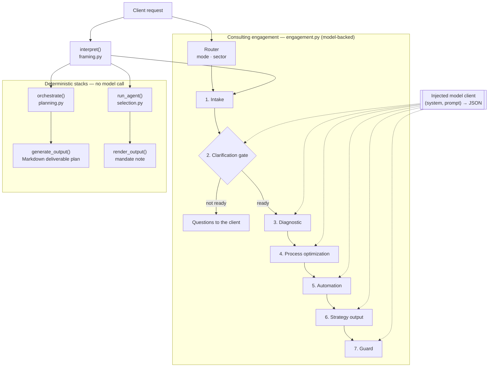

# Khirami Agent

[](https://github.com/nassim-systems/khirami-agent/actions/workflows/ci.yml)


The core of an AI business-consulting agent: it frames a client request,
routes it through a consulting pipeline, and guards the deliverable before it
reaches the client. Pure Python, standard library only, fully deterministic
outside the model calls.

## The problem

A language model asked to "help with our support backlog" tends to answer
like an engineer or a salesperson. It jumps to tools, invents figures,
automates broken processes and loses track of why each recommendation exists.

Khirami Agent puts a consulting discipline around the model:

- **Frame before answering.** Requests are parsed into objective, recipient,
  tone, depth, constraints, quoted focus and measurable targets. Gaps are
  named, and low-confidence requests trigger at most two clarification
  questions.
- **Process before automation.** The automation stage only sees the
  *redesigned* process, never the current one.
- **Traceability.** Every action must point to an upstream root cause,
  bottleneck or automation candidate. A deterministic guard flags orphans,
  missing owners, missing done-conditions, engineering jargon and hype.
- **No invented data.** Without a model client, stages return empty
  contracts and declare the gap. They never fabricate content.

## Architecture



`interpret()` is the only function that reads the raw request. Every later
stage consumes its structured frame.

| Module | Role |
| --- | --- |
| `framing.py` | Request framing and language detection (en, fr, es, it, pt) |
| `engagement.py` | Seven-stage consulting pipeline around one `EngagementState` |
| `prompts.py` | System prompt and one JSON-contract prompt per model-backed stage |
| `planning.py` | `orchestrate()`: request → deliverable plan (template, sections, status) |
| `selection.py` | Capabilities, render format and content rules derived from the frame |
| `rendering.py` | `generate_output()` (Markdown plan) and `render_output()` (consulting note) |
| `agent.py` | `KhiramiAgent.run()`: single entry point over the two deterministic stacks |
| `constraints.py` | Standalone constraint extractor (six languages, not yet wired in) |
| `style.py` | Voice and writing-brief registry (reference, not yet wired in) |
| `lexicons/` | Per-language keyword data — the only non-English text in the source |

Design decisions are recorded in [`docs/adr/`](docs/adr/), and the full
architecture is described in [`docs/architecture.md`](docs/architecture.md).

## The seven-stage engagement pipeline

A deterministic router runs first. It sets the execution mode and the sector
reference table, and defaults the output language to English. Then:

| # | Stage | Model call | What the code enforces |
| --- | --- | --- | --- |
| 1 | **Intake** | no | Frame with `confidence` and `missing_info` |
| 2 | **Clarification gate** | only on low confidence | Questions only when confidence is low; two at most; can pause the run |
| 3 | **Diagnostic** | yes | Three root causes at most; ranking limited to known causes |
| 4 | **Process optimization** | yes | Bottlenecks not linked to a diagnosed root cause are dropped |
| 5 | **Automation** | yes | Sees the target flow only; unknown mechanisms dropped; an empty `do_not_automate` is declared as a gap |
| 6 | **Strategy output** | yes | Three horizons (now / next / later); `quick_scan` keeps three fields only |
| 7 | **Guard** | only if a rule fails | Deterministic checks first; the model is called for a correction only when a violation is found |

Execution modes select which stages run:

| Mode | Stages after the gate |
| --- | --- |
| `full_audit` (default) | diagnostic → process → automation → strategy → guard |
| `quick_scan` | diagnostic → strategy |
| `automation_focus` | process → automation → strategy |
| `follow_up` | strategy |

Every model response must be a JSON object. Invalid JSON is retried once
with the parse error in context. On a second failure, the gap is recorded in
`state.meta.degraded`.

## Installation

```bash
git clone https://github.com/nassim-systems/khirami-agent.git
cd khirami-agent
python -m pip install -e ".[dev]"
```

Python 3.10 or later. No runtime dependency.

## Usage

### Frame a request

```python
from khirami_agent import interpret

interpret(
    "Our support team is overwhelmed. We need a diagnosis and an action plan "
    "to reduce response times by 30% before Q3."
)
```

```json
{
  "objective": "plan",
  "objectives": ["analyze", "plan"],
  "subject": "team",
  "focus": "reduce response times",
  "measures": {"direction": "decrease", "quantity": "30", "deadline": "Q3"},
  "target": "team",
  "tone": "direct",
  "depth": "standard",
  "constraints": [],
  "missing_info": [],
  "confidence": "high"
}
```

(The `request` key, which echoes the input, is omitted here.)

### Run the consulting engagement with a model

The pipeline takes any callable `client(system_prompt, task_prompt) -> str`
that returns the JSON object each prompt asks for. **No provider adapter ships
with this repository**: wire in the SDK of your choice.

```python
from khirami_agent import run_engagement


def client(system_prompt: str, task_prompt: str) -> str:
    """Call your model here and return its raw text answer."""
    raise NotImplementedError


state = run_engagement(
    "Our support team is overwhelmed. We need a diagnosis and an action plan "
    "to reduce response times by 30% before Q3.",
    business_context={"sector": "support"},
    client=client,
    mode="full_audit",
)

state.strategy  # executive summary, findings, 3-horizon plan, KPIs, risks
state.audit  # guard verdict and violations
state.meta.degraded  # every gap the pipeline declared
```

Without a client, the same call returns empty blocks, and every model-backed
stage that runs adds a `"<stage>: no generation client configured"` entry to
`state.meta.degraded`.

### Deterministic stacks

```python
from khirami_agent import KhiramiAgent

agent = KhiramiAgent()
agent.run("Write a detailed and precise analysis for the client.")  # Markdown plan
agent.run("Our support team is overwhelmed...", modern=True)  # mandate note (dict)
```

The second call returns:

```json
{
  "executive_summary": "Mandate: diagnosis then action plan — reduce response times. Recipient: an internal team.\nStake: conclude without exceeding what is needed.\nTarget: targeted decrease — reference 30 — horizon Q3.\nApproach: establishing the causes, sequencing the execution, ranking the content.\nDecision expected: settle the success criterion.",
  "analysis": "Observation. Double mandate — diagnosis then action plan. Focus: reduce response times. ...",
  "recommendations": [
    "Establish the causes before any proposal: no recommendation without an identified cause.",
    "Sequence the steps and name their dependencies: no step without an explicit prerequisite.",
    "..."
  ],
  "format": "action_plan",
  "meta": {"non_regression": true, "deterministic": true}
}
```

These stacks produce *structure*: a deliverable outline or a mandate note
derived from the frame. They contain no business findings, which only the
model-backed pipeline can produce.

## Tests

```bash
pytest
```

The suite has 297 tests and makes no network call. The model client is
replaced by a stub that returns canned JSON. The tests cover:

- framing contracts, edge cases and the same request in five languages,
- language detection (threshold, ties, never a wrong language),
- every selection rule and its priority order,
- every engagement stage contract, the guard rules, retry on invalid JSON and
  every execution mode,
- determinism and non-mutation of inputs for the public functions.

CI runs `ruff check`, `ruff format --check` and `pytest` on Python 3.10–3.13
for every push and pull request.

## Known limitations

- **No model adapter.** The engagement pipeline has an injection point but no
  Anthropic or OpenAI integration. Without one, the model-backed stages return
  empty contracts.
- **Lexical framing.** `interpret()` matches keywords. It does not understand
  paraphrases outside its lexicons. Words it does not know are ignored, never
  guessed.
- **`volumes` is never reported as missing.** `_missing_information()` tests
  the measures dictionary, which always holds three keys, so this gap never
  fires even when no quantity is stated.
- **Accented input in the engagement router.** The router matches its
  accent-folded sector and mode markers against text that is lower-cased but
  not accent-folded, so a marker written with accents in the request is
  missed.
- **Quantities lose their unit symbol.** "30%" is captured as `"30"`.
- **Two modules are not wired in.** `constraints.py` and `style.py` are tested
  or documented, but no decision path calls them.
- **No persistence or multi-client layer.** State lives in memory for one
  call.

## Roadmap

- Provider adapters implementing the `client` callable, with retries and
  timeouts.
- Fix the two framing and router defects listed above, with regression tests.
- Feed `render_output()` from a completed `EngagementState`, so the
  deterministic renderer can format model-produced findings.
- Wire `constraints.py` into framing for numeric bounds (word and bullet
  limits).
- A command-line entry point.

## License

Copyright (c) 2026 nassim-systems. All rights reserved. This is proprietary
software: no license is granted. See [LICENSE](LICENSE).
